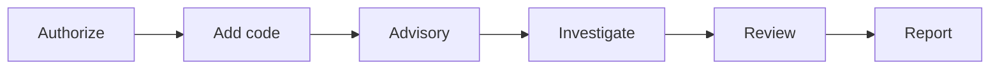

<h1 align="center"> Astrolabe</h1>

<p align="center">
  <strong>Local, consultant-led code triage with Antares-1B.</strong>
</p>

<p align="center">
  
  
</p>

<p align="center">
  <a href="#install">Install</a> ·
  <a href="#quickstart">Quickstart</a> ·
  <a href="#documentation">Documentation</a> ·
  <a href="#license">License</a>
</p>

Astrolabe is a point-in-time engagement tool for a software security assessment. Using a local Antares-1B small language model, you can evaluate a snapshot and the model names candidate files for a known advisory (CVE or GHSA) or a chosen CWE (Common Weakness Enumeration). You confirm what belongs in the produced report.

> **Important**
> Astrolabe is not a scanner of record and it is not a merge gate. Model output is a candidate list for the consultant.
> Weights are not included. You obtain Antares-1B yourself after accepting the Hugging Face gate.

## What it does

Astrolabe is meant to make the Antares small language model practical and simplify its use for a code-review engagement. Antares searches one repository and names files that may relate to an advisory or a CWE. Astrolabe then wraps that run in the consultant’s work: record the customer's authorization, freeze one snapshot, evaluate the provided code, review every candidate, and write the assessment. Only a candidate you confirm on the current snapshot is a finding in that report.

## How it works



1. **Authorize.** Record the customer's written authorization and the scope it covers.
2. **Add code.** Intake a local tree, archive, or git clone. Astrolabe stores a hardened snapshot.
3. **Advisory.** Choose a cached advisory, paste advisory text, or search the local CWE catalog.
4. **Investigate.** Antares-1B names candidate files from inside a container with `network=none`.
5. **Review.** You read each candidate and record a verdict.
6. **Report.** Generate the assessment and the remediation handoff, then finalize.

## Requirements

| | |
|---|---|
| **Primary platform** | Apple Silicon Mac, Docker running, 24 GB RAM recommended |
| **Also present in the code** | Linux socket defaults under `$XDG_RUNTIME_DIR`. Not release-tested. |
| **Not supported** | Windows as the operator host |
| **Dependencies** | Python 3.11+, Docker, git. PDF rendering needs WeasyPrint and Pango (`brew install pango` on macOS). |
| **Weights** | Antares-1B. Request access at [fdtn-ai/antares-1b](https://huggingface.co/fdtn-ai/antares-1b) and put the model in `./models/1b`. |
| **Network** | Install downloads Python dependencies from PyPI, including torch and transformers. `astrolabe setup` builds the sandbox image, which contacts Docker Hub, ghcr.io, Debian, and PyPI. After that, runtime network use is advisory sync and git clone. |

## Install

```bash
git clone https://github.com/briansak/astrolabe.git
cd astrolabe
```

Request access at [fdtn-ai/antares-1b](https://huggingface.co/fdtn-ai/antares-1b), download the model, and put it in `models/1b`. That directory needs `model.safetensors`, `config.json`, and `antares-cli.zip`.

```bash
./astrolabe up
```

`up` creates `.venv` on first run, installs this checkout, checks that Docker is running, and uses Antares-1B from `--model-path`, `ANTARES_MODEL_PATH`, the saved config, or `./models/1b`. It builds the sandbox image when the image is missing or was built from a different CLI zip, runs doctor, and starts the inference server and the UI in the background. The UI is at `http://127.0.0.1:8765/`. Re-running `up` prints that URL when Astrolabe is already up.

The first install contacts PyPI. The image build contacts Docker Hub, ghcr.io, Debian, and PyPI. A weights download, only with `--download-weights` or a yes at the prompt, contacts Hugging Face.

```bash
./astrolabe status
./astrolabe doctor
./astrolabe logs
./astrolabe down
```

`status` prints whether the processes are up, the URL, and a doctor summary. `doctor` is the same checks on their own. `logs` prints the server and UI logs; `./astrolabe logs --follow` keeps printing them. `down` stops both processes.

Prerequisites, an existing weights directory, and the release wheel are in [docs/install.md](docs/install.md).

## Quickstart

One synthetic engagement, from an empty home directory. Details are in [docs/quickstart.md](docs/quickstart.md).

1. `astrolabe start` and open the UI.
2. Create an engagement for customer Acme, scope "Billing service", with your name as consultant.
3. Record an authorization reference.
4. Add a local folder or zip of sample code.
5. Paste a short advisory, or import one into the advisory cache.
6. Run the advisory-guided check and wait for the queue to finish.
7. Open Review and record a verdict on each candidate.
8. Generate the assessment, finalize it, and export the report bundle.

## Security model

The UI binds `127.0.0.1` and checks `Origin` and `Sec-Fetch-Site` on POST. The inference server listens on a Unix socket. The socket directory and the token directory are mode 0700 and sit outside the engagements root.

Each investigation runs in its own container: `network=none`, a read-only root, a read-only snapshot, dropped capabilities, and no new privileges. The container is removed when the run ends. `ANTARES_DATA_DIR` inside the container is the engagement data directory.

The only operator network use after setup is advisory sync (OSV and GitHub) and git clone or fetch during intake. Setup's image build is the exception: it contacts Docker Hub, ghcr.io, Debian, and PyPI. The `uv` image is pinned by digest.

Customer text is redacted before it is stored in notes, traces shown to you, and exports. A finalized report exports byte for byte. Check mode refuses an export whose bytes do not match the finalized files. Purge deletes the engagement directory. Exports you already wrote under `~/Astrolabe/exports` stay until you handle them.

## Accuracy and limitations

In our testing on 34 published vulnerabilities, advisory-guided investigation identified the affected file in roughly 7 of 10 runs, compared with about 1 in 4 without an advisory. Results on this codebase may differ.

Model output by itself is not a finding.

Candidates have no line numbers. An empty candidate list is not evidence that the snapshot has no weakness. Re-running a check is recorded and does not increase CWE coverage. A verdict from an older snapshot stays out of the report until you re-confirm it.

## Documentation

- [Install](docs/install.md)
- [Quickstart](docs/quickstart.md)
- [Concepts](docs/concepts.md)
- [Workflow](docs/workflow.md)
- [Review and reporting](docs/review-and-reporting.md)
- [Security](docs/security.md)
- [Data handling](docs/data-handling.md)
- [Configuration](docs/configuration.md)
- [CLI](docs/cli.md)
- [Troubleshooting](docs/troubleshooting.md)
- [Changelog](docs/CHANGELOG.md)

## License

Apache License 2.0. See [LICENSE](LICENSE).

## Third-party notices

CWE content is © The MITRE Corporation. See `astrolabe/data/cwe/CWE_NOTICE.txt`.

Antares-1B and IBM Granite terms are yours to accept before you download the weights. Astrolabe does not redistribute the weights or the Antares CLI zip. See [THIRD_PARTY_NOTICES.md](THIRD_PARTY_NOTICES.md).

## Support

Report a problem to the partner who gave you this build. This release does not publish a public issue tracker.
