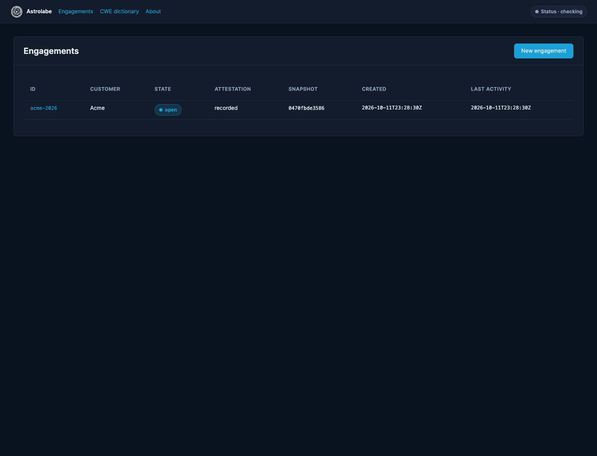

# Quickstart

A synthetic engagement. Use a sample repository you are allowed to copy, not a customer tree.

## Start

```bash
astrolabe start
```

Open `http://127.0.0.1:8765/`. The landing page lists engagements and the Status menu.



Screenshots in these docs use the synthetic Acme engagement `acme-2026`.

## Create

Choose new engagement. Customer `Acme`, scope `Billing service`, start date today, consultant your name, authorization reference `SOW-14`. Submit.

## Authorize

Open the engagement. On Authorize, confirm the written authorization covers the scope and record it. The audit log gains an attestation line.

## Add code

On Add code, choose a local folder or zip. Review the intake preview and confirm. Astrolabe writes a hardened snapshot and shows its SHA-256. Test paths are omitted unless you include them.

## Advisory

Import a local advisory JSON into the cache, or paste advisory text on the advisory plan. Investigations read the cache. They do not call the network.

```bash
astrolabe advisories import /path/to/advisory-json-directory
```

## Investigate

Choose Check an advisory, pick the CWE, and start the queue. One check runs at a time. The status row under the running check shows phase, counters, and the last action.

## Review

Open Review. Each candidate card names a next step, what to look for, and the first mitigation. Record a verdict and a note. Confirmed notes appear in the customer report.

## Report

Generate the assessment and the remediation handoff. When every candidate is confirmed or not actionable, Finalize. Export the report bundle. The customer archive is the finalized HTML, status, and PDF when a PDF was produced.

Close the engagement when the work is done. Purge deletes the engagement directory after you confirm that exports have been handled.
