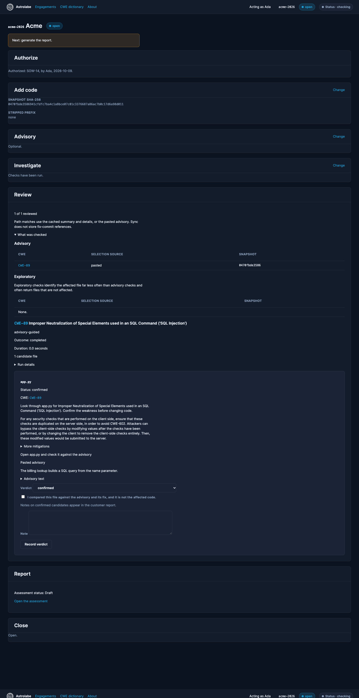
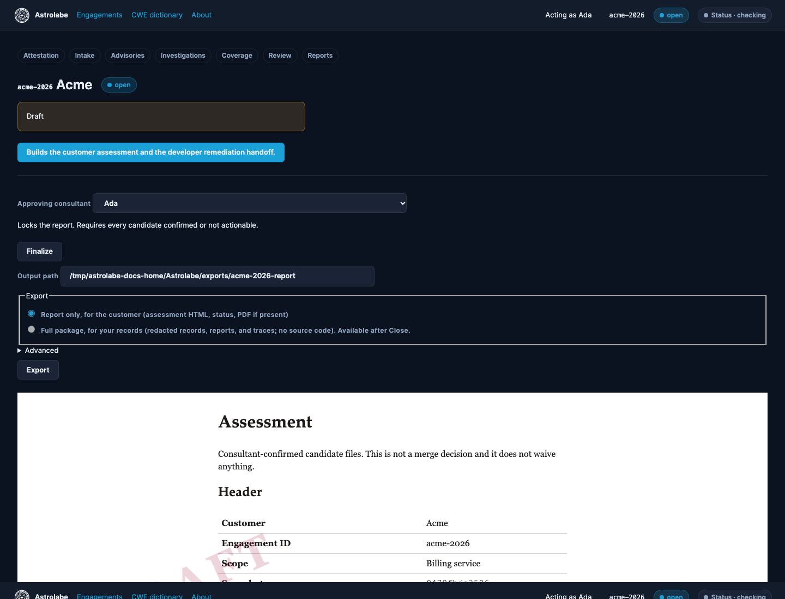

# Review and reporting

## Verdicts

On each candidate card, choose `confirmed`, `not_actionable`, or `needs_more_info`, and write a note. The note on a confirmed candidate is the consultant explanation in the assessment. Notes are redacted before they are stored.

A stale verdict is one recorded against an older snapshot. Re-confirm it on the current snapshot before it can appear in the report.

## Advisory guardrail

When the advisory names the file, dismissing it (`not_actionable` or `needs_more_info`) requires the comparison checkbox. The UI keeps that candidate out of a silent dismissal.

## Finalize

Finalize is refused while any candidate is still pending, needs more information, or needs re-review on the current snapshot. The message names each group.

Finalize rewrites the assessment as final, names the approving consultant, and records the time. Generate, Finalize, and verdict changes are then refused. The report template version is 1. An assessment saved without that version is template 0 and cannot be regenerated or re-finalized.

## Report contents

The assessment sections are Header, Summary, Findings, What was checked, Method and limitations, and Appendix. Findings use one `article.finding` per confirmed file. The Appendix holds the full snapshot SHA-256. Coverage tables show the 12-character prefix.

The required sentences in Method and limitations are fixed text, including:

In our testing on 34 published vulnerabilities, advisory-guided investigation identified the affected file in roughly 7 of 10 runs, compared with about 1 in 4 without an advisory. Results on this codebase may differ.

Model output by itself is not a finding.

A draft shows the DRAFT watermark. A final report does not.

If the PDF was not produced, the HTML is still written and the report page says "The PDF was not produced."

## Export

Report only: the assessment HTML, the status file, and the PDF when it exists. This is the customer archive. It is refused while the assessment is still a draft unless you pass the draft allowance.

Full package: redacted records, reports, and traces, without the customer source. Available after Close.

Check mode compares the exported bytes with the finalized files and refuses the archive when they differ. Fix the source report and finalize again.

## Remediation handoff

`remediation.md` lists every confirmed candidate and the MITRE mitigation text, with reference markers removed. It tells the reader to confirm the weakness before changing code. It is not a patch and it has no line numbers. The JSON handoff carries the same candidates.
