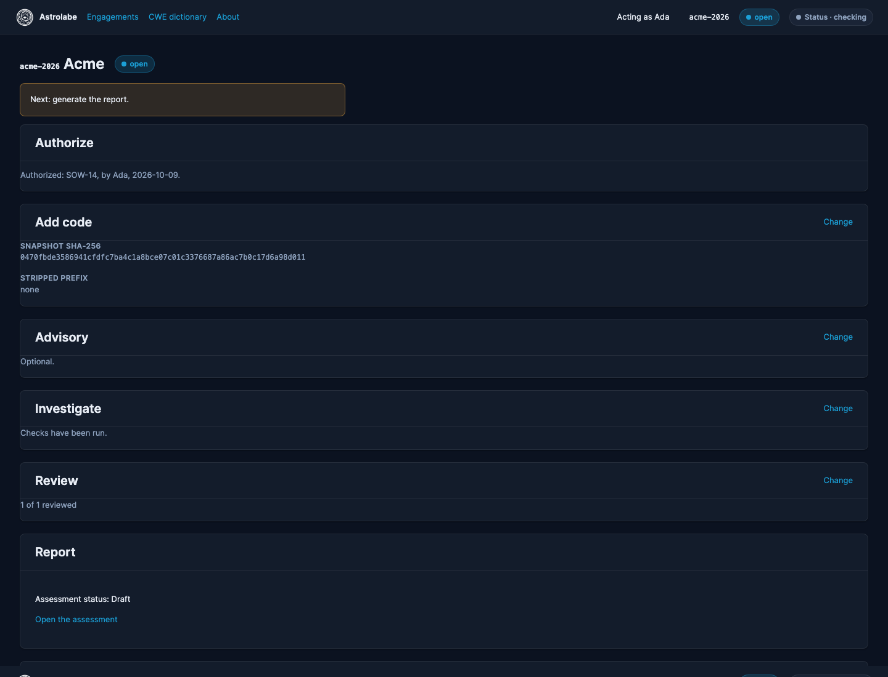

# Workflow

The engagement page is a sequence of steps. A later step stays blocked until the earlier ones it needs are recorded.

## Authorize

Records the authorization reference, the scope, the consultant, and the time. Until this exists, Investigate and the plan pages stay blocked. The audit log stores the attestation. Replacing the code does not erase it.

## Add code

Accepts a local directory, an archive, a single file, or a git clone of a URL and ref. Clone and fetch are a network use. A local path is not.

Confirming intake writes the hardened snapshot: symlinks are dropped, external hardlinks are omitted, and path escapes are refused. Test paths are excluded unless you opt in. The snapshot SHA-256 is the binding for later verdicts.

## Advisory

The advisory cache lives at `~/Astrolabe/advisories` unless `ASTROLABE_ADVISORY_CACHE` is set. Sync downloads advisory JSON from OSV and GitHub and is refused while a check is running. Import copies a directory of JSON you already have and does not use the network.

You can paste advisory text for one check. Pasted text is labeled "Pasted advisory text" in the assessment coverage table.

## Investigate

Needs authorization and a snapshot. Check an advisory, or explore without one. The queue runs one investigation at a time. Cancel stops the running container. Start or Restart queues the check again.

Each run stores its snapshot SHA-256, the trace name, and an activity summary: start, end, exit status, phases, and counters.

## Review

One card per candidate file in an investigation. Cards are ordered by the best submission rank, then path. You record a verdict and a note. The UI refuses an actor who is not on the engagement's consultant list. The advisory guardrail asks you to confirm you compared the file with the advisory before a dismissal when the advisory names that file.

## Report

Generate writes the assessment HTML and, when WeasyPrint and Pango are available, the PDF. Finalize locks the report after every candidate is confirmed or not actionable. A final report cannot be regenerated. Export writes a tar.gz under `~/Astrolabe/exports` unless you choose another path. Close ends the engagement. Purge deletes the engagement directory and writes the durable audit log.
